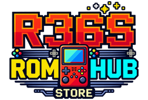

<p align="center">
  
</p>

<h1 align="center">R36S ROM HUB STORE</h1>

<p align="center"><strong>Sua central de jogos retrô</strong><br>ROMs, BIOS, temas e ferramentas direto no console.</p>

<p align="center">
  <a href="https://github.com/JammesPark/R36S-ROMS-HUB-STORE-UPDATES/releases/latest"></a>
  
  
  <a href="LICENSE"></a>
</p>

<p align="center">
  
  
  
  
</p>
<p align="center">🇧🇷 Português (Brasil) &nbsp; · &nbsp; 🇺🇸 English &nbsp; · &nbsp; 🇪🇸 Español &nbsp; · &nbsp; 🇷🇺 Русский</p>

**Status:** versão 0.7.0-beta — beta oficial.

---

## 💡 Sobre o projeto

O **R36S ROM HUB STORE** é um aplicativo independente para consoles portáteis R36S, com suporte ao R36H como alvo de compatibilidade. Desenvolvido em Lua e LÖVE 11.5, permite organizar jogos, baixar e instalar ROMs em SD1 ou SD2, gerenciar BIOS, temas e utilizar ferramentas do sistema diretamente com os controles físicos do console.

A interface tem resolução lógica de 640×480, dois temas integrados (Pulse e Matrix) e quatro idiomas selecionáveis. O aplicativo tem origem no R36S PORT HUB, de Lag do Lira, e preserva a autoria de ferramentas e temas herdados.

---

## ⚠️ Aviso importante

Este é um projeto independente, em fase BETA, feito pela comunidade. Não somos autores, proprietários ou representantes dos jogos, ROMs, BIOS, temas e demais conteúdos de terceiros. A licença do aplicativo não autoriza automaticamente seu acesso ou redistribuição. Respeite os direitos autorais e utilize apenas arquivos para os quais tenha autorização.

A compatibilidade varia conforme modelo, firmware e tela. Faça backup dos cartões e da instalação antes de alterações; ferramentas de manutenção podem modificar arquivos mediante confirmação. Relate falhas de funcionamento e não confunda versões experimentais com as oficiais.

---

## ⬇️ Downloads

| Pacote | Download |
|---|---|
| 📦 Instalação completa 0.7.0-beta | [Baixar ZIP](https://github.com/JammesPark/R36S-ROMS-HUB-STORE-UPDATES/releases/download/store-v0.7.0-beta/R36S_ROMS_STORE_0.7.0-beta.zip) |
| 🔄 Atualização 0.7.0-beta (OTA) | [Baixar ZIP de atualização](https://github.com/JammesPark/R36S-ROMS-HUB-STORE-UPDATES/releases/download/store-v0.7.0-beta/R36S_ROMS_STORE_0.7.0-beta_OTA.zip) |
| 🆕 Versão oficial mais recente | [Página permanente de download](https://github.com/JammesPark/R36S-ROMS-HUB-STORE-UPDATES/releases/latest) |
| 🗂️ Versões anteriores | [Histórico oficial](https://github.com/JammesPark/R36S-ROMS-HUB-STORE-UPDATES/releases) |

Para uma instalação nova, use o pacote completo, sem o sufixo OTA. Para atualizar uma instalação existente, prefira o menu de atualização online da loja. Os links de ZIP acima são da versão indicada; a página da última versão permanece fixa.

---

## 🎨 Temas e interface

| Pulse Edition | Matrix Edition |
|:---:|:---:|
| Paleta azul original | Paleta verde original |
| Logo centralizada e menu principal | Painel de catálogo e menu 3×3 |
| Lista, Grade e Vitrine | Lista, Grade e Vitrine |

Ambos são integrados à loja, com cores personalizáveis de forma independente. São adaptações de temas originais de Lag do Lira.

---

## ✨ Funcionalidades

| | Função | Descrição |
|---|---|---|
| 🎮 | **ROMs** | Jogos por sistema, detalhes, busca, favoritos e capas quando disponíveis. |
| 🕹️ | **Biblioteca de jogos** | Consulta jogos presentes nos emuladores do console, com opção de iniciar o jogo. |
| 📦 | **Instalados** | Gerenciamento das ROMs instaladas pela loja. |
| ⭐ | **Favoritos** | Marcar e desmarcar jogos e consultar os itens favoritos. |
| 💾 | **SD1/SD2** | Escolha do cartão de destino para instalação. |
| 🖼️ | **Visualização** | Modos Lista, Grade e Vitrine em Pulse e Matrix. |
| ⬇️ | **Downloads** | Fila, progresso, velocidade, histórico e operações em segundo plano. |
| 🧩 | **BIOS do Sistema** | Área de verificação, download e instalação de BIOS, com gerenciamento de arquivos. |
| 🎨 | **Temas Store** | Consulta e instalação de temas da interface do console. |
| ⚙️ | **Configurações** | Aparência, cores, brilho, áudio, notificações e preferências. |
| 🔄 | **Atualizações** | Consulta online, confirmação, verificação de pacote, histórico e recuperação. |
| 🌐 | **Quatro idiomas** | 🇧🇷 PT-BR, 🇺🇸 EN, 🇪🇸 ES e 🇷🇺 RU. |

---

## 🛠️ Utilidades e ferramentas

As ferramentas abaixo foram identificadas no código e nas telas da versão atual. Parte delas foi herdada ou adaptada do R36S PORT HUB, por Lag do Lira. A disponibilidade depende das permissões, dos componentes e do firmware do console.

| Ferramenta | Função |
|---|---|
| **Analisador do cartão SD** | Espaço usado e livre, tamanho das pastas e maiores arquivos. |
| **Verificador do cartão SD** | Identificação do cartão, indícios de capacidade falsa e teste rápido de velocidade. |
| **Manutenção do cartão SD** | Operações de manutenção com confirmação. |
| **Verificador de integridade dos ports** | Confere scripts, pastas e dependências do PortMaster. |
| **R36S Analog Tester** | Teste de analógicos e botões, com relatório. Ferramenta de Lag do Lira. |
| **Teste de controles** | Verifica as entradas reconhecidas pela interface. |
| **Diagnóstico de rede** | Informações de rede, sinal, DNS e teste de conexão e velocidade. |
| **Gerenciar Wi-Fi** | Consulta e conexão a redes disponíveis. |
| **Servidor FTP** | Transferência de arquivos pela rede local. |
| **Gerenciador de arquivos** | Navegação e operações nos arquivos do cartão. |
| **PortMaster e runtimes** | Gerenciamento do PortMaster e dos runtimes necessários aos ports. |
| **Analisador de console** | Identificação do aparelho e consulta de informações do sistema. |
| **R36 Control** | Ajustes do console quando suportados pelo sistema. |
| **Bateria e energia** | Consulta das informações de energia disponíveis. |
| **Data e hora** | Configuração de horário e fuso. |
| **Transmissão e gravação** | Recursos de transmissão pela rede local e gravação da interface. |
| **Backup e restauração** | Backup, exportação e recuperação de configurações. |
| **Diagnóstico e suporte** | Consulta dos registros de erros do aplicativo. |

---

## 🚀 Instalação no R36S

1. Baixe o pacote completo na [página de download oficial](https://github.com/JammesPark/R36S-ROMS-HUB-STORE-UPDATES/releases/latest).
2. Extraia os arquivos na pasta `ports` do cartão de destino.
3. Confira a estrutura:

   ```text
   ports/
   ├── R36S ROMS STORE.sh
   └── r36sromsstore/
   ```

4. Reinicie o EmulationStation, se necessário, e abra o aplicativo na seção Ports.
5. Conecte o console à internet para a primeira sincronização.

**Requisito:** runtime LÖVE 11.5 disponível no aparelho. O pacote oficial é preparado para os caminhos de instalação originais; a organização do código no GitHub não modifica esses caminhos.

---

## 🎮 Controles

| Botão | Ação |
|---|---|
| Direcional / analógico esquerdo | Navegação, seleção e rolagem. |
| **A** | Abrir, confirmar, selecionar ou executar a ação indicada. |
| **B** | Voltar, cancelar ou abrir a saída no menu principal. |
| **X** | Pesquisa na lista de ROMs; outras ações conforme a tela. |
| **Y** | Atualiza a lista de ROMs; ações contextuais em outras telas. |
| **L1 / R1** | Alternam categorias, abas ou páginas nas telas compatíveis. |
| **L2 / R2** | Alternam os modos de visualização nas listas de ROMs compatíveis. |
| **SELECT** | Marca ou desmarca favoritos; abre a atualização quando há aviso no menu. |
| **START** | Abre a Central de Downloads; na tela Sobre, abre o apoio ao projeto. |
| **FN** | Captura de tela quando reconhecido pelo sistema; no teste de controles, é testado sem capturar. |
| Analógico direito / L3 / R3 | Sem atalho global definido no mapeamento geral; consultar o teste de controles. |

As funções contextuais aparecem no rodapé das telas. O mapeamento físico pode variar conforme o firmware.

---

## 🖥️ Compatibilidade e testes

| Aparelho / sistema | Situação |
|---|---|
| R36S | Funcionamento confirmado em console; versão 0.7.0-beta e sincronização dos dados testadas pelo responsável. |
| dArkOSen | Testado em console; foram observadas diferenças no mapeamento de controles em relação a outro sistema. |
| R36H | Alvo de compatibilidade; confirmação física específica pendente. |
| ArkOS, dArkOS e dArkOSRE | Famílias de sistemas de referência; não há confirmação individual completa nesta versão. |
| Outras telas e clones | Compatibilidade em validação; correções experimentais não integram automaticamente a versão oficial. |

A documentação não certifica todos os firmwares ou aparelhos. Informe o modelo, o sistema e a versão ao relatar problemas.

---

## 🔄 Atualizações

Use o menu de atualização online da loja. A publicação oficial exige aprovação e testes; versões experimentais permanecem em canal separado. Não instale pacotes experimentais sobre a versão oficial sem backup.

---

## 📖 Documentação

| Documento | Conteúdo |
|---|---|
| [CHANGELOG.md](CHANGELOG.md) | Histórico de versões |
| [CONTRIBUTORS.md](CONTRIBUTORS.md) | Registro de contribuições |
| [PUBLICACAO_OFICIAL.md](docs/PUBLICACAO_OFICIAL.md) | Processo de publicação |
| [REORGANIZACAO.md](docs/REORGANIZACAO.md) | Organização dos arquivos |
| [NOTICE.md](NOTICE.md) | Autoria e avisos |
| [LICENSE](LICENSE) | Licença GPL-3.0 |

A pasta `docs/` preserva também documentos do projeto-base, que podem citar versões e caminhos antigos.

---

## 🗂️ Estrutura do projeto

```text
src/       Código-fonte Lua/LÖVE, temas e recursos
port/      Launcher e arquivos de instalação no console
tools/     Build, ferramentas e serviços auxiliares
tests/     Testes automatizados
docs/      Documentação, protótipos e arquivos históricos
.github/   GitHub Actions
```

Para gerar o pacote: `sh tools/build.sh`. O GitHub Actions valida LuaJIT, testes e integridade dos ZIPs.

---

## 💬 Comunidade

Canal oficial: [Telegram — R36SPORTSBR](https://t.me/R36SPORTSBR).

Relatos de bugs e sugestões: [GitHub Issues](https://github.com/JammesPark/R36S-ROMS-HUB-STORE/issues).

---

## 🤝 Contributors

- **[JammesPark](https://github.com/JammesPark)** — criador, responsável pelo projeto, direção visual e testes no console.
- **[ChatGPT (OpenAI)](https://chatgpt.com/)** — colaboração no desenvolvimento assistido por IA desde o início do projeto.
- **[Lag do Lira](https://github.com/liralflsti-wq/r36s-port-hub)** — autor do projeto-base, dos temas originais e de ferramentas herdadas do R36S PORT HUB.

Veja o [registro completo das contribuições](CONTRIBUTORS.md).

---

## 🙏 Autoria, licença e uso responsável

Baseado no **R36S PORT HUB, por [Lag do Lira](https://youtube.com/@lagdolira)**. Pulse Edition e Matrix Edition são adaptações dos temas originais do autor, com créditos preservados. Parte das ferramentas e dos utilitários também foi herdada ou adaptada do projeto-base; sua autoria original é de Lag do Lira, respeitados os créditos e as licenças de componentes de terceiros.

Código sob GNU GPL-3.0, conforme [LICENSE](LICENSE), [NOTICE.md](NOTICE.md) e avisos de terceiros. A licença do aplicativo não concede direitos sobre ROMs, BIOS, capas ou outros conteúdos de terceiros. Utilize somente arquivos para os quais tenha direito de acesso, download e distribuição.

<p align="center"><strong>R36S ROM HUB STORE</strong><br>Desenvolvimento colaborativo para a comunidade retrô.</p>
