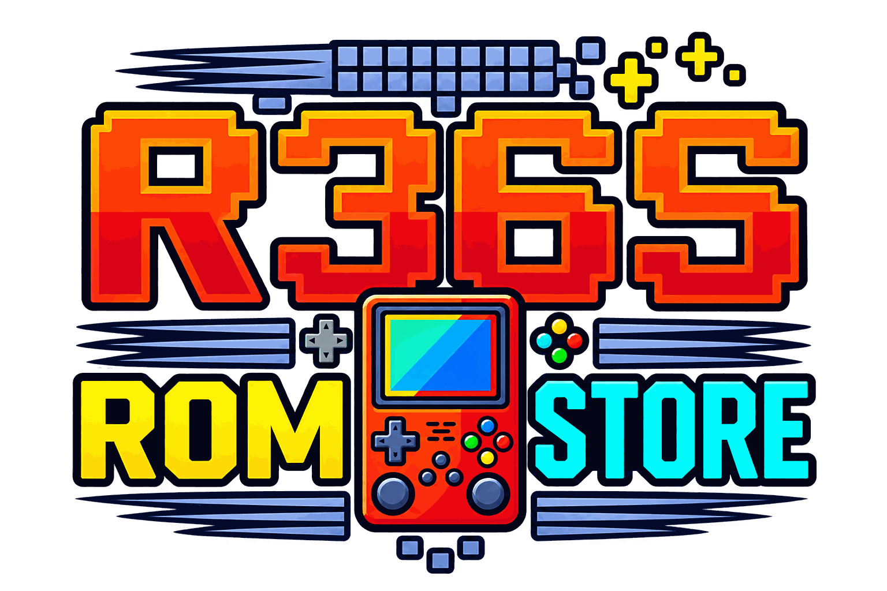
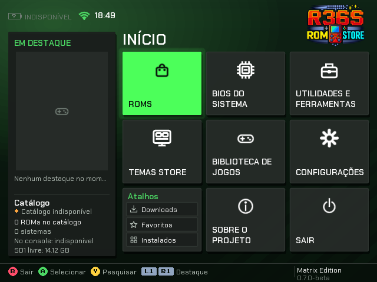
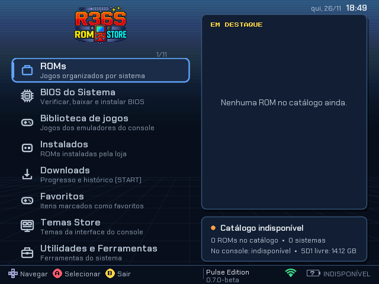

# R36S ROM STORE

  
  

[🇧🇷 Português](../README.md) · [🇺🇸 English](README.en.md) · [🇪🇸 Español](README.es.md) · [🇷🇺 Русский](README.ru.md)

**Status:** 0.7.0-beta — official beta.

## About

Independent retro gaming manager for R36S and R36H, written in Lua and LÖVE 11.5. ROM catalog, search, covers, favorites, local library, SD1/SD2 installation, BIOS, EmulationStation themes, download queue, history and device tools. Two built-in themes, Matrix and Pulse; four languages.

## Important notice

⚠️ **BETA version.** The main features have been tested in a simulated environment on a computer and on R36S and R36H handhelds. Some functions and operating-system combinations still need additional validation. Community bug reports, suggestions and contributions are welcome.

Back up your cards and use only content you are authorized to access. The GPL-3.0 software license does not grant rights to third-party ROMs, BIOS, artwork or themes.

## Downloads

[Official releases](https://github.com/JammesPark/R36S-ROM-STORE-UPDATES/releases) · [Current launcher (.sh)](../port/R36S%20ROMS%20STORE.sh) (requires the complete ZIP).

## Interface

Approved visual identity for the next edition; actual LÖVE screenshots at 640×480 from an isolated environment. The currently available release is 0.7.0-beta.

| Matrix Edition | Pulse Edition |
|:---:|:---:|
|  |  |

## Installation

Extract the complete 0.7.0-beta ZIP into `ports/` on the card. Open `R36S ROMS STORE.sh` beside `r36sromsstore/` in EmulationStation with LÖVE 11.5 available. Connect to the internet for initial synchronization.

## Compatibility and tests

R36S and R36H have both been physically tested by the maintainer. dArkOSen was tested with controller-mapping differences. Installation on ArchR was tested. dArkOSRE, dArkOS, ArkOS and Omni36OS are reference systems; full validation of every combination remains pending.

## Updates

Use the in-app online updater for official releases. Back up before updating.

## Development and credits

Lua/LuaJIT/LÖVE, Python, Shell Script, HTML, JSON/YAML/XML, Markdown, GitHub Actions and Cloudflare R2. Based on R36S PORT HUB by Lag do Lira; JammesPark maintains the derivative, with assistance from ChatGPT (OpenAI). Original theme/tool authorship and third-party licenses are preserved.

[Telegram](https://t.me/R36SPORTSBR) · [GitHub Issues](https://github.com/JammesPark/R36S-ROM-STORE/issues) · [GPL-3.0](../LICENSE) · [NOTICE](../NOTICE.md) · [Contributors](../CONTRIBUTORS.md)
