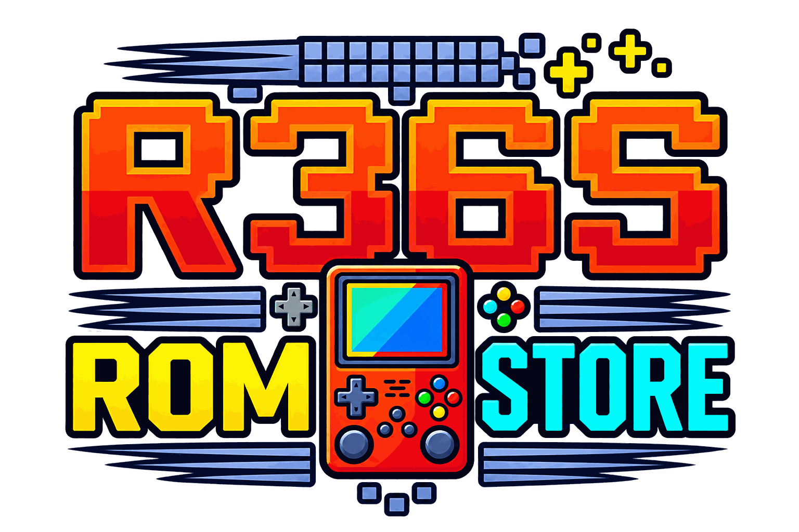
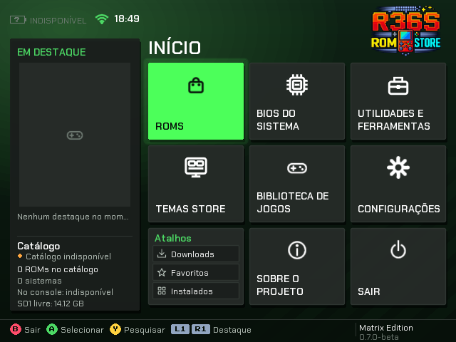
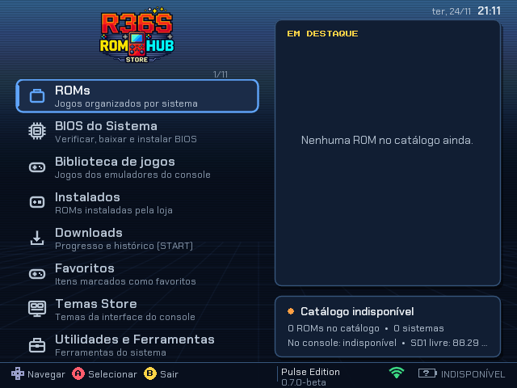

# R36S ROM STORE

  
  

[🇧🇷 Português](../README.md) · [🇺🇸 English](README.en.md) · [🇪🇸 Español](README.es.md) · [🇷🇺 Русский](README.ru.md)

**Estado:** 0.7.0-beta — beta oficial.

## Acerca del proyecto

Gestor independiente de juegos retro para R36S y R36H, desarrollado en Lua y LÖVE 11.5. Catálogo de ROMs, búsqueda, carátulas, favoritos, biblioteca local, instalación SD1/SD2, BIOS, temas de EmulationStation, cola e historial de descargas y herramientas. Dos temas integrados, Matrix y Pulse; cuatro idiomas.

## Aviso importante

⚠️ **Versión BETA.** Las funciones principales se han probado en un entorno simulado en el ordenador y en las consolas R36S y R36H. Algunas funciones y combinaciones de sistemas operativos aún requieren validación adicional. Se agradecen los informes de errores, sugerencias y contribuciones de la comunidad.

Haga copias de seguridad y utilice únicamente contenido autorizado. GPL-3.0 no concede derechos sobre ROMs, BIOS, imágenes o temas de terceros.

## Descargas

| Paquete | Descarga |
|---|---|
| Instalador automático (.sh), última versión oficial activa con OTA | [Descargar SH](https://raw.githubusercontent.com/JammesPark/R36S-ROM-STORE/main/INSTALAR_R36S_ROM_STORE.sh) |
| Instalación completa 0.7.0-beta con OTA | [ZIP](https://github.com/JammesPark/R36S-ROM-STORE/releases/download/store-v0.7.0-beta/R36S_ROMS_STORE_0.7.0-beta.zip) |
| Actualización manual 0.7.0-beta | [UPDATE.zip](https://github.com/JammesPark/R36S-ROM-STORE/releases/download/store-v0.7.0-beta/R36S_ROMS_STORE_0.7.0-beta_UPDATE.zip) |
| Versiones anteriores | [Historial oficial](https://github.com/JammesPark/R36S-ROM-STORE/releases) |

Copie el SH en ports, conecte a internet y ejecútelo desde EmulationStation. Descarga y verifica el instalador oficial activo. Validación automatizada aprobada; prueba física de este script pendiente. La actualización manual contiene solo la carpeta de la aplicación, incluido game.love, sin lanzador ni datos personales. Úsela únicamente en una instalación existente de la misma estructura y haga una copia de seguridad. El ZIP completo ya incluye OTA.

## Interfaz

Identidad visual aprobada para la próxima edición; capturas reales de LÖVE a 640×480 en un entorno aislado. La versión disponible sigue siendo 0.7.0-beta.

| Matrix Edition | Pulse Edition |
|:---:|:---:|
|  |  |

## Instalación

Extraiga el ZIP completo 0.7.0-beta en `ports/` de la tarjeta. Abra `R36S ROMS STORE.sh` junto a `r36sromsstore/` desde EmulationStation con LÖVE 11.5 disponible. Conéctese a internet para la sincronización inicial.

## Compatibilidad y pruebas

El responsable ha probado físicamente R36S y R36H. Se probó dArkOSen con diferencias de controles y la instalación en ArchR. dArkOSRE, dArkOS y ArkOS son sistemas de referencia; falta validar por completo todas las combinaciones.

## Actualizaciones

Use el actualizador en línea de la tienda para versiones oficiales. Haga una copia de seguridad antes de actualizar.

## Desarrollo y créditos

Lua/LuaJIT/LÖVE, Python, Shell Script, HTML, JSON/YAML/XML, Markdown, GitHub Actions y Cloudflare R2. Basado en R36S PORT HUB de Lag do Lira; JammesPark mantiene la adaptación con ayuda de ChatGPT (OpenAI). Se preservan los créditos y licencias originales.

[Telegram](https://t.me/R36SPORTSBR) · [GitHub Issues](https://github.com/JammesPark/R36S-ROM-STORE/issues) · [GPL-3.0](../LICENSE) · [NOTICE](../NOTICE.md) · [Contributors](../CONTRIBUTORS.md)
