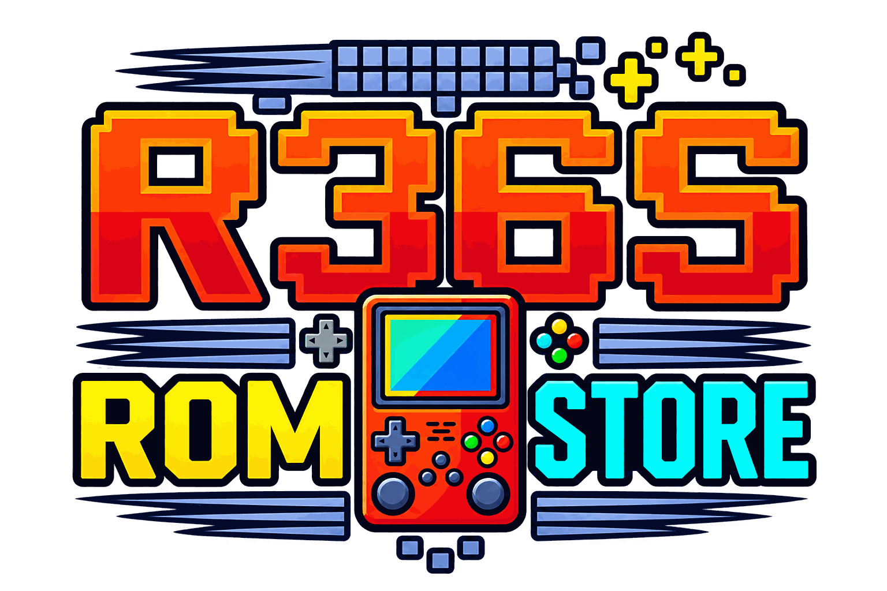
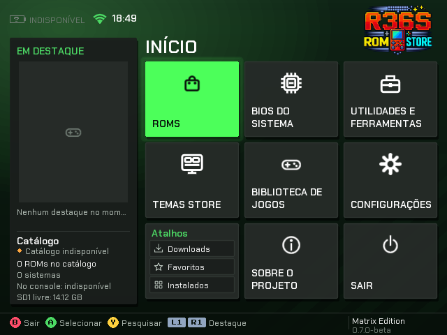
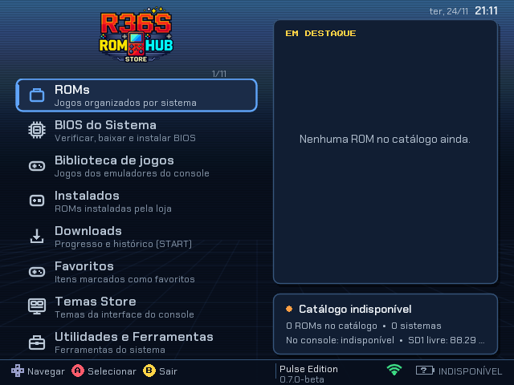

# R36S ROM STORE

  
  

[🇧🇷 Português](../README.md) · [🇺🇸 English](README.en.md) · [🇪🇸 Español](README.es.md) · [🇷🇺 Русский](README.ru.md)

**Статус:** 0.7.2-beta — официальный бета-выпуск.

## О проекте

Независимое приложение для ретроигр на R36S, разработанное на Lua и LÖVE 11.5. Управление ROM, BIOS, темами EmulationStation и инструментами с помощью кнопок консоли, SD1/SD2 и логического разрешения 640×480. Обе консоли, R36S и R36H, были проверены сопровождающим проекта на реальных устройствах. Основано на R36S PORT HUB автора Lag do Lira; не является официальным продуктом исходного проекта или производителя.

## Важно

⚠️ **Бета-версия.** Основные функции протестированы в симулированной среде на компьютере и на консолях R36S и R36H. Некоторые функции и сочетания операционных систем требуют дополнительной проверки. Приветствуются сообщения об ошибках, предложения и вклад сообщества.

Бета-версия: создайте резервную копию карт памяти. Используйте только материалы, на доступ и распространение которых у вас есть разрешение. GPL-3.0 относится к коду приложения, а не к сторонним играм, BIOS, изображениям или темам. Совместимость зависит от устройства.

## Загрузки

| | Download |
|---|---|
| Автоматический установщик (.sh) — активная официальная версия с OTA | [SH](https://raw.githubusercontent.com/JammesPark/R36S-ROM-STORE/main/INSTALAR_R36S_ROM_STORE.sh) |
| Полная установка с OTA | [ZIP](https://github.com/JammesPark/R36S-ROM-STORE/releases/download/store-v0.7.2-beta/R36S_ROM_STORE_0.7.2-beta.zip) |
| Ручное обновление | [UPDATE.zip](https://github.com/JammesPark/R36S-ROM-STORE/releases/download/store-v0.7.2-beta/R36S_ROM_STORE_0.7.2-beta_UPDATE.zip) |
| Предыдущие выпуски | [Releases](https://github.com/JammesPark/R36S-ROM-STORE/releases) |

Для переноса с 0.7.0-beta или более ранней версии используйте SH или полный ZIP. UPDATE.zip требует новой структуры r36sromstore/. Создайте резервную копию. Старый канал OTA остаётся на 0.7.0-beta. SH нового канала прошёл автоматические тесты; отдельная проверка на консоли ещё не подтверждена.

## Интерфейс

| Matrix Edition | Pulse Edition |
|:---:|:---:|
|  |  |

Matrix — тема по умолчанию при новой установке; Pulse — альтернативная. Независимые цвета, список, сетка и витрина. Реальные снимки приложения в 640×480 в изолированной среде, не показания физической консоли.

## Возможности

- Каталог ROM: более 15 000 записей в проверенной коллекции, поиск, обложки, региональные метки, избранное и категории систем; количество меняется при обновлении каталога.
- Локальная библиотека, выбор SD1/SD2, управление ROM, установленными через магазин.
- Магазин тем: 100 тем в проверенном каталоге, предпросмотр, фоновая установка, активация, обновление и удаление установленных тем, включая внешние. Предупреждение для непроверенных тем; защита активной и системных тем.
- Общая очередь ROM и тем: скорость, прогресс, оставшееся время, отмена загрузки, история и переход к подробностям.
- BIOS и инструменты: SD-карты, кнопки и стики, диагностика сети, Wi-Fi, FTP, файловый менеджер, PortMaster/runtimes, информация об устройстве, резервные копии и журналы (зависит от прошивки).
- Оформление, цвета, размер текста и четыре языка; последний корректный каталог и кэш обложек доступны офлайн.

## Установка и перенос данных

Создайте резервную копию. Распакуйте полный ZIP в папку `ports/` карты. В новой структуре `R36S ROM STORE.sh` находится рядом с `r36sromstore/`, содержащей `game.love`. Запустите приложение через Ports в EmulationStation при наличии LÖVE 11.5. Для первой синхронизации подключитесь к интернету.

Для первого переноса используйте полный установщик. Сохраните старую папку, скрипт запуска и резервные копии до проверки данных на карте. У новой структуры свой канал OTA. Прежний канал остаётся на версии 0.7.0-beta.

## Управление

| Кнопка | Действие |
|---|---|
| Крестовина / левый стик | Навигация |
| A / B | Подробности/подтверждение / назад/отмена |
| X | Поиск ROM, установка тем, очистка истории загрузок |
| Y | Контекстное действие, удаление темы, информация и действия загрузки |
| L1/R1 | Категории и фильтры |
| L2/R2 | Виды ROM и предпросмотр тем |
| SELECT | Избранное ROM; выбор системы/экрана тем |
| START | Загрузки; настройки тем; поддержка в разделе «О программе» |
| FN | Снимок экрана при наличии поддержки |

## Совместимость и помощь

R36S и R36H проверены сопровождающим проекта на реальных устройствах. dArkOSen тестировался, ранее отмечались различия в кнопках. Установка на ArchR проверена. dArkOSRE, dArkOS и ArkOS — системы, учитываемые при разработке; полная проверка отдельных сочетаний устройств и прошивок ещё предстоит. сведения о темах AmberELEC, ROCKNIX, JELOS, KNULLI и Batocera не означают полной сертификации приложения. Автоматическое уведомление об обновлении тем и удаление темы, установленной строго вручную, не проверены физически. Удаление тем ThemeMaster и тем вне каталога проверено. Перенос данных и физическая проверка одобрены сопровождающим; отдельная проверка нового канала OTA и SH на консоли не подтверждена.

Интернет нужен для первой синхронизации и загрузок. Перед удалением активной темы выберите другую. При ошибке укажите версию, прошивку и действия, не публикуйте пароли или личные данные.

[Telegram](https://t.me/r36sportsromstorebr) · [Issues](https://github.com/JammesPark/R36S-ROM-STORE/issues) · [Помощь (PT-BR)](SUPORTE.md)

## Разработка и авторство

Код: `src/`; сборка: `sh tools/build.sh`. [История](../CHANGELOG.md) · [Планы после выпуска](ROADMAP.md) · [Процесс публикации](HISTORICO_RELEASES.md). Рейтинги и другие планы — будущие предложения, а не текущие функции.

[JammesPark](https://github.com/JammesPark) · [Lag do Lira](https://github.com/liralflsti-wq/r36s-port-hub) · [ChatGPT (OpenAI)](https://chatgpt.com/) · [NOTICE](../NOTICE.md) · [Contributors](../CONTRIBUTORS.md) · [GPL-3.0](../LICENSE)

Lag do Lira — автор исходного проекта, оригинальных тем Matrix/Pulse и унаследованных инструментов. JammesPark поддерживает производный проект; ChatGPT помогает в разработке. Снимки ThemeGallery: Dave, MIT. Сохраняются сторонние лицензии и авторство.
